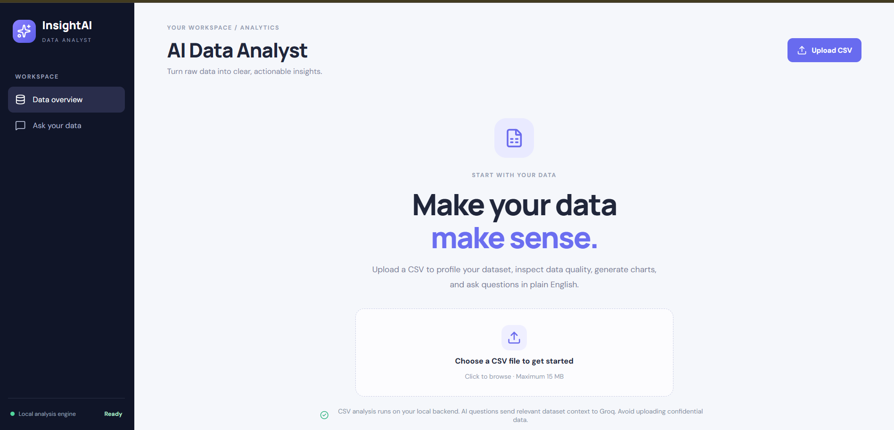

# InsightAI - AI Data Analyst

InsightAI is a web-based data analysis platform that transforms raw CSV data into useful insights. It combines data profiling, data quality checks, data cleaning, interactive visualizations, business analytics, downloadable reports, and an AI-powered data assistant.

## Features

- **CSV Upload and Analysis:** Upload CSV files and generate an analysis profile.
- **Data Profiling:** Explore row counts, columns, data types, unique values, missing cells, and statistical summaries.
- **Data Quality Checker:** Identify missing values, duplicate rows, outliers, and potential data quality issues.
- **Data Cleaning:** Preview cleaning operations, apply supported changes, reset to the original dataset, and download cleaned data.
- **Interactive Charts:** Visualize trends and relationships in uploaded datasets.
- **Business Analytics:** Analyze sales, profit, profit margin, and product or regional performance when the required data is available.
- **AI Data Assistant:** Ask natural-language questions about your dataset using the configured Groq API integration.
- **Calculated Answers:** Get direct answers for supported data questions using backend calculations.
- **Downloadable Reports:** Export analysis reports in JSON and PDF formats.
- **Dataset Preview:** Inspect uploaded data before drawing conclusions.

## Tech Stack

| Area | Technologies |
|---|---|
| Frontend | React, JavaScript, Vite, CSS |
| Backend | Python, FastAPI, Uvicorn |
| Data Analysis | Pandas, NumPy |
| AI Integration | Groq API |
| Testing | pytest |
| Version Control | Git and GitHub |

## Project Structure

```text
ai-data-analyst/
├── backend/
│   ├── main.py
│   ├── requirements.txt
│   └── tests/
│       └── test_cleaning.py
├── frontend/
│   ├── src/
│   │   ├── App.jsx
│   │   ├── cleaning.css
│   │   ├── main.jsx
│   │   └── styles.css
│   ├── index.html
│   ├── package.json
│   ├── package-lock.json
│   └── vite.config.js
├── sample_data/
│   ├── customer_orders.csv
│   └── sales.csv
├── screenshots/
│   └── dashboard.png
├── .gitignore
└── README.md
```

## Prerequisites

- Python 3.11 or a compatible Python version
- Node.js and npm
- A Groq API key for AI-assisted questions

## Installation and Setup

### 1. Clone the Repository

```bash
git clone https://github.com/ankit123-stack/insightai-data-analyst.git
cd insightai-data-analyst
```

### 2. Set Up the Backend

Open a terminal in the project root and run:

```powershell
cd backend
python -m venv venv
.\venv\Scripts\Activate.ps1
pip install -r requirements.txt
```

### 3. Configure Environment Variables

Create a file named `.env` inside the `backend` directory and add:

```env
GROQ_API_KEY=your_groq_api_key_here
GROQ_MODEL=openai/gpt-oss-20b
```

Replace the example key with your own Groq API key. If your backend uses a different model, use the model configured in your application.

**Security:** Never commit your real API key or `.env` file to GitHub. The repository's `.gitignore` should exclude these files.

### 4. Start the Backend

Run this command from the `backend` directory:

```bash
uvicorn main:app --reload --port 8000
```

Backend URLs:

- API: http://127.0.0.1:8000
- Interactive API documentation: http://127.0.0.1:8000/docs
- Health check: http://127.0.0.1:8000/api/health

Keep this terminal running.

### 5. Set Up the Frontend

Open a second terminal in the project root and run:

```powershell
cd frontend
npm install
npm run dev
```

Open the local URL printed by Vite in the terminal, usually `http://localhost:5173`.

If Vite selects a different port, use the URL it displays. If the frontend cannot reach the backend, verify the API URL and ensure the backend's CORS configuration allows the frontend's current origin.

## How to Use InsightAI

1. Start the backend and frontend.
2. Open InsightAI in your browser.
3. Upload a CSV dataset.
4. Review the data profile and quality indicators.
5. Explore charts, statistics, and available business analytics.
6. Ask questions about your dataset using the AI Data Assistant.
7. Preview and apply supported data cleaning operations.
8. Download analysis reports or cleaned data when needed.

Sample CSV datasets are available in the `sample_data/` directory.

## API Endpoints

| Method | Endpoint | Purpose |
|---|---|---|
| GET | `/` | API status |
| GET | `/api/health` | Health check |
| POST | `/api/upload` | Upload and analyze a CSV |
| POST | `/api/clean/{dataset_id}/preview` | Preview cleaning changes |
| POST | `/api/clean/{dataset_id}/apply` | Apply cleaning changes |
| POST | `/api/clean/{dataset_id}/reset` | Reset cleaning changes |
| GET | `/api/clean/{dataset_id}/download` | Download cleaned data |
| GET | `/api/chart/{dataset_id}` | Generate chart data |
| GET | `/api/analytics/{dataset_id}` | Calculate business analytics |
| POST | `/api/ask` | Ask a question about a dataset |

Visit `/docs` while the backend is running to inspect request schemas, parameters, and responses.

## Important Notes

- Uploaded datasets are held in backend memory. Restarting the backend can clear loaded datasets.
- AI-generated responses can contain inaccuracies. Verify important claims against the underlying data.
- Do not upload confidential business information or personally identifiable data to a public deployment.
- Keep API credentials private and out of source control.
- This project is intended for learning, demonstration, and portfolio purposes.

## Future Improvements

- Deploy the frontend and backend.
- Expand automated test coverage.
- Improve data validation and error handling.
- Strengthen validation of AI-generated insights.
- Add persistent dataset storage where needed.
- Add a live demo link.

## Author

**Ankit Kumar**

- GitHub: https://github.com/ankit123-stack
- Project Repository: https://github.com/ankit123-stack/insightai-data-analyst

## Screenshots

### InsightAI Dashboard



